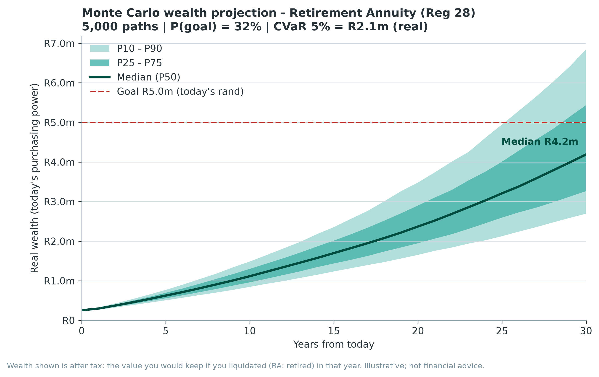
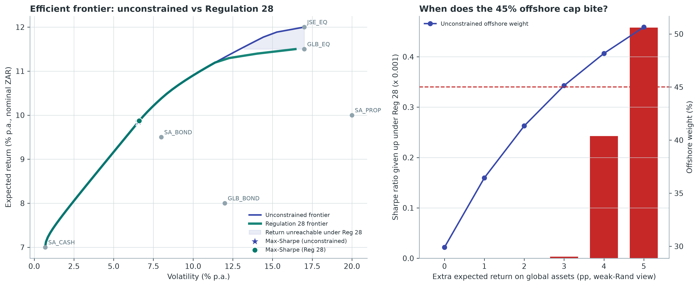
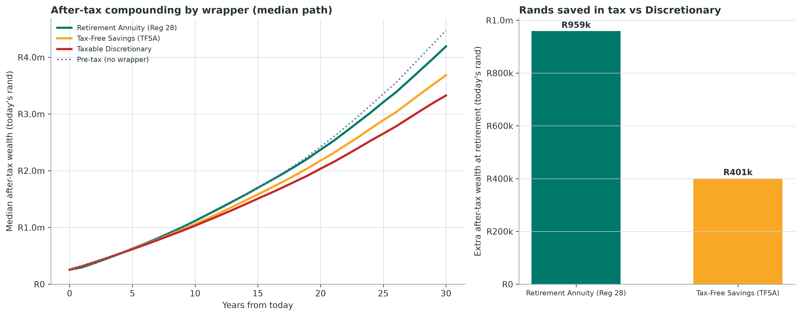
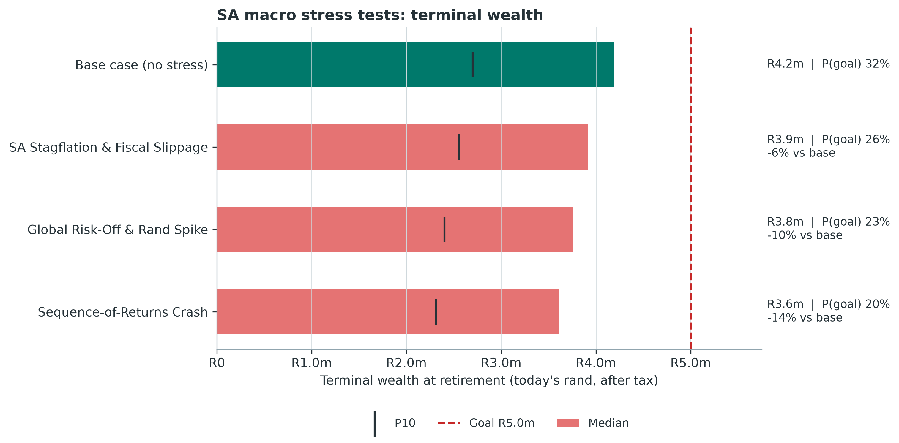
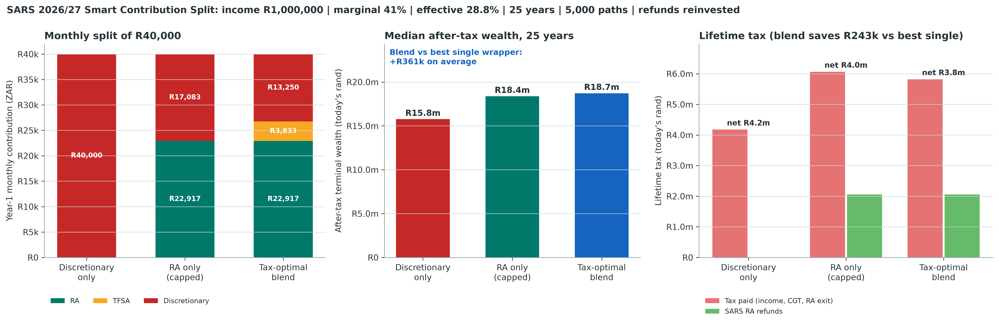
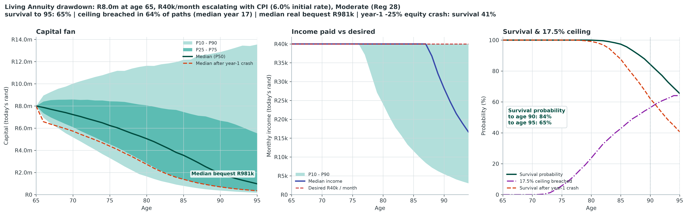

# sa-wealth-reg28-simulator

**South African Regulation 28 Private Wealth, SARS Tax-Optimisation & Living Annuity Drawdown Simulator**

**[Launch Live Interactive Dashboard](https://streamlit.app)**

[](https://github.com/carterhorrmann-beep/sa-wealth-reg28-simulator/actions/workflows/ci.yml)


A quantitative wealth-management toolkit for a South African investor, from the first contribution to the last drawdown (**v2.0: Lifecycle Wealth & SARS Tax-Optimisation upgrade**). It answers six questions:

1. **What does Regulation 28 actually cost me?** Constrained (SLSQP) vs unconstrained portfolios, efficient frontiers and a cap-by-cap breakdown.
2. **Will I reach my retirement goal?** A 5,000-10,000 path, seeded, Cholesky-correlated Monte Carlo of six ZAR asset classes with stochastic SA CPI, reported in nominal and today's rand.
3. **Which wrapper should hold the money?** Retirement Annuity vs Tax-Free Savings Account vs taxable Discretionary account, run on identical market paths.
4. **What if South Africa has a bad decade?** Stagflation, a global risk-off with a Rand spike, and a sequence-of-returns crash just before retirement.
5. **How should I split my monthly budget?** A SARS 2026/27 Smart Contribution Allocator: exact progressive tax and RA refund, then the optimal Rand split across RA, TFSA and Discretionary, with the lifetime tax saved and the extra after-tax wealth it creates.
6. **Will my Living Annuity last?** A 5,000-path drawdown engine inside the statutory 2.5% to 17.5% band: survival probability to age 90 / 95, real bequest, when the 17.5% ceiling bites, and a -25% equity crash in year 1 of retirement.

It ships as a Python package, a `sa-wealth` CLI, high-DPI charts and a 5-tab Streamlit dashboard that exports a client wealth plan as Markdown.

> **Disclaimer:** an educational modelling project, not financial advice. Capital market assumptions are long-run illustrations, not forecasts, and tax law changes every Budget.

## Gallery

| Monte Carlo fan chart | Regulation 28 frontier & offshore cap |
|---|---|
|  |  |

| Tax wrappers | Macro stress scenarios |
|---|---|
|  |  |

**SARS 2026/27 Smart Contribution Split** (R40,000/month on a R1m taxable income, 25 years)



**Living Annuity drawdown** (R8m at 65, R40,000/month in today's rand, 30 years, year-1 -25% equity crash overlaid)



*(Default accumulation plan: 30-year horizon, R250k lump sum, R5,000/month escalating with CPI, R5m goal in today's rand, "Moderate (Reg 28)" portfolio, 36% marginal rate, 5,000 paths, seed 42. The two v2.0 charts use the plans in their captions, same seed and paths.)*

## Quick start

```bash
git clone https://github.com/carterhorrmann-beep/sa-wealth-reg28-simulator.git
cd sa-wealth-reg28-simulator

python -m venv .venv
source .venv/bin/activate            # Windows: .venv\Scripts\activate
pip install -e ".[app,dev]"          # add ,yf for the optional yfinance loader

pytest -q                            # offline test-suite
sa-wealth simulate                   # Monte Carlo with the default plan
sa-wealth smart-split                # SARS-aware RA / TFSA / Discretionary split
sa-wealth drawdown                   # Living Annuity survival & ruin analysis
streamlit run app/streamlit_app.py   # interactive 5-tab dashboard
```

### Deploy on Streamlit Community Cloud

1. Push the repository to `github.com/carterhorrmann-beep/sa-wealth-reg28-simulator`.
2. On [share.streamlit.io](https://share.streamlit.io) choose **New app**, pick the repository and set the main file path to `app/streamlit_app.py`.
3. `requirements.txt` contains `scipy>=1.11` and `-e .[app]`, so the package and Streamlit install without further configuration.

## CLI

```text
sa-wealth simulate     Monte Carlo wealth projection (+ --report plan.md for the client plan)
sa-wealth optimize     Regulation 28 optimiser vs unconstrained, cap-by-cap cost, offshore sensitivity
sa-wealth tax-compare  RA vs TFSA vs Discretionary on identical paths
sa-wealth stress       SA macro stress scenarios
sa-wealth smart-split  SARS 2026/27 tax profile + optimal monthly split across RA, TFSA and Discretionary
sa-wealth drawdown     Living Annuity decumulation: survival, bequest, 17.5% ceiling breach, year-1 crash
sa-wealth charts       writes docs/fan_chart.png, reg28_frontier.png, tax_wrappers.png, stress_scenarios.png,
                       living_annuity.png and smart_split.png
```

```bash
sa-wealth simulate --initial 500000 --monthly 8000 --years 28 --target 9000000 \
                   --marginal 0.41 --preset aggressive --paths 10000 --wrapper RA --report plan.md
sa-wealth simulate --weights "JSE_EQ=20,GLB_EQ=70,SA_BOND=10" --wrapper TFSA
sa-wealth optimize --target-return 11
sa-wealth tax-compare --tax-year 2026/27
sa-wealth smart-split --budget 40000 --income 1000000 --years 25            # SARS 2026/27 by default
sa-wealth smart-split --budget 15000 --income 650000 --age 66 --no-reinvest  # age-based rebates, refund spent
sa-wealth drawdown --capital 8000000 --monthly-income 40000 --years 30 --retire-age 65
sa-wealth drawdown --capital 5000000 --monthly-income 30000 --portfolio aggressive-offshore --fee 1.0
sa-wealth charts --out docs --dpi 300
```

Presets: `conservative`, `moderate`, `aggressive`, `offshore-growth`, `jse-home-bias`, `max-sharpe`, `risk-parity`.
`--source yfinance` re-estimates the assumptions from market data (see below).

## Python API

```python
from sa_wealth import SimulationConfig, simulate, run_tax_comparison, run_stress, default_assumptions

a = default_assumptions()
cfg = SimulationConfig(initial_lump_sum=250_000, monthly_contribution=5_000,
                       horizon_years=30, target_real=5_000_000, n_paths=10_000, marginal_rate=0.36)
w = {"JSE_EQ": .30, "SA_BOND": .25, "SA_PROP": .05, "SA_CASH": .05, "GLB_EQ": .25, "GLB_BOND": .10}

res = simulate(cfg, w, a)
res.prob_goal, res.cvar5_real, res.cumulative_tax_drag
res.percentiles(real=True)            # P10 / P25 / P50 / P75 / P90 by year
run_tax_comparison(cfg, w, a).summary
run_stress(cfg, w, a).table
```

```python
from sa_wealth import (DrawdownConfig, run_drawdown, run_crash_impact,
                       optimize_wrapper_split, income_tax_profile, ra_tax_refund)

# SARS 2026/27: marginal / effective rate, tax payable and the exact RA refund
p = income_tax_profile(650_000, age=40)
p.marginal_rate, p.effective_rate, p.tax_payable, p.ra_deduction_limit, p.ra_refund
ra_tax_refund(100_000, 650_000)                         # R36,000: the whole deduction sits in the 36% bracket

# Smart Contribution Allocator (identical paths for all three strategies)
split = optimize_wrapper_split(40_000, 1_000_000, None, 25, n_paths=5_000)
split.optimal_split                                     # {"RA": ..., "TFSA": ..., "DISC": ...} per month, year 1
split.gain_vs("discretionary")                          # terminal-wealth gain and lifetime tax saved
split.comparison()                                      # one row per strategy

# Living Annuity
impact = run_crash_impact(DrawdownConfig(initial_capital=8_000_000, monthly_income_real=40_000, horizon_years=30))
impact.base.survival_prob(), impact.base.survival_milestones()   # to age 95; ages 90 / 95
impact.base.median_bequest_real, impact.base.cap_breach_prob, impact.base.median_years_to_cap_breach
impact.table                                            # base vs year-1 -25% equity crash
```

## Repository layout

```text
src/sa_wealth/
  assets.py      6 ZAR asset classes, CMA table, correlation matrix (incl. CPI & Rand-strength factors),
                 stochastic CPI, ZAc/ZAR sanitiser and optional yfinance loader
  reg28_tax.py   Regulation 28 validator + SLSQP optimiser, frontiers, trade-off analytics,
                 RA / TFSA / Discretionary tax engine, SARS 2025/26 & 2026/27 income-tax tables,
                 exact RA refund and the Smart Contribution Allocator (optimize_wrapper_split)
  montecarlo.py  Cholesky Monte Carlo, metrics (P(goal), CVaR 5%, tax drag), tax comparison, stress tests
  drawdown.py    Living Annuity decumulation: 2.5%-17.5% band, survival, ceiling breach, year-1 crash
  plots.py       high-DPI matplotlib charts
  report.py      Markdown client wealth plan
  cli.py         the `sa-wealth` command
app/streamlit_app.py   5-tab dashboard
tests/                 test_assets / test_reg28 / test_tax / test_montecarlo / test_drawdown / test_cli / test_app (offline)
docs/                  generated charts
```

## Methodology

### Assets and returns (`assets.py`)

| Code | Asset | E[return] | Vol | Income yield | Taxed as |
|---|---|---|---|---|---|
| `JSE_EQ` | JSE All Share / Top 40 | 12.0% | 17.0% | 3.0% | local dividend (20% DWT) |
| `SA_BOND` | ALBI / SAGBs | 9.5% | 8.0% | 8.5% | interest (marginal rate, after exemption) |
| `SA_PROP` | SA listed property | 10.0% | 20.0% | 7.5% | property distribution (marginal rate) |
| `SA_CASH` | STeFI / money market | 7.0% | 0.7% | 7.0% | interest |
| `GLB_EQ` | Global developed equity in ZAR | 11.5% | 17.0% | 1.6% | foreign dividend (effective 20%) |
| `GLB_BOND` | Global aggregate bonds in ZAR | 8.0% | 12.0% | 4.0% | foreign interest (marginal rate) |

* Monthly **log** returns with the drift set so the annual *arithmetic* mean equals the assumption, correlated via the Cholesky factor of an 8x8 correlation matrix: six assets, an SA **CPI shock** and a **ZAR-strength** factor (negative of USD/ZAR). A stronger Rand lowers the ZAR value of global assets, so `GLB_EQ` and `GLB_BOND` are negatively correlated with ZAR strength (-0.55 / -0.85) while SA bonds and property are positively correlated. The matrix is validated as positive definite in the tests.
* **SA CPI**: mean 5.5% (adjustable). The annualised inflation rate follows an AR(1) deviation (persistence 0.97/month, stationary volatility 1.5%) so shocks are persistent and correlated with asset returns. Contributions escalate with the *realised* CPI path and every result can be shown nominal or in today's rand.
* **`--source yfinance`** uses the liquid proxies `STX40.JO`, `NFGOVI.JO`, `STXPRO.JO`, `USDZAR=X`, `SPY`, `AGG`. `SPY` and `AGG` are converted to ZAR via USD/ZAR. JSE ETFs are quoted in cents (ZAc), and vendors occasionally flip the unit mid-history, so every series goes through `sanitise_zac_series`, which detects 100x / 0.01x day-on-day jumps and rescales the earlier segment (real crashes are untouched). Sample statistics are blended 50/50 with the CMAs, because a short ETF history is a noisy estimate of long-run returns. `SA_CASH` and the CPI factor keep their CMA values.

### Regulation 28 (`reg28_tax.py`)

Limits: equity (`JSE_EQ + GLB_EQ`) <= 75%, offshore (`GLB_EQ + GLB_BOND`) <= 45%, listed property <= 25%, long-only, fully invested. `optimize_portfolio` uses `scipy.optimize.minimize(method="SLSQP")` with multi-start for max-Sharpe, min-variance (with an optional return target) and equal-risk-contribution (risk parity); `max_return` uses an exact LP. `project_to_reg28` returns the closest compliant allocation, which is what the RA holds when a client's preferred portfolio breaches the limits.

### What Regulation 28 costs: findings at the base assumptions

* The unconstrained max-Sharpe portfolio (about 60% SA bonds, 30% offshore, 26% equity) is **already compliant**, so at the Sharpe optimum the limits cost nothing.
* The limits bind on the **growth end** of the frontier: the highest reachable expected return is **11.5%** under Regulation 28 vs **12.0%** unconstrained, and a Reg 28 investor targeting about 11.3% needs roughly 0.3 percentage points more volatility.
* The **45% offshore cap is slack** at the base assumptions. `offshore_sensitivity` adds a "weak-Rand" premium to global assets: the cap starts to bind at roughly +3 percentage points, and even at +5 points the Sharpe given up is about 0.0005, because other assets substitute for the extra offshore weight.

These are properties of the chosen CMAs. Change `CMA_TABLE` and the picture changes, which is the point of the tool.

### Tax wrappers (`reg28_tax.py`)

| | RA | TFSA | Discretionary |
|---|---|---|---|
| Allocation | Regulation 28 | unconstrained | unconstrained |
| Tax on dividends / interest / CGT | 0% | 0% | 20% DWT; interest above the R23,800 exemption at the marginal rate; CGT at 40% x marginal rate (18% at 45%) after a R40,000 annual exclusion |
| Contributions | upfront deduction: 27.5% of income, max R350,000 a year, refund reinvested | R36,000 a year, R500,000 lifetime | unlimited |
| At the end | 1/3 lump sum on the retirement table (first R550,000 free), 2/3 annuity at an assumed retirement marginal rate (min(your rate, 31%)) | none | CGT on all unrealised gains |

Implementation notes:

* All wrappers run on **identical market paths** (common random numbers), so differences are purely tax.
* Income is paid monthly, taxed by character, and reinvested. In the Discretionary account gains are realised when the portfolio rebalances back to target each year and at liquidation, with an annual exclusion and capital-loss carry-forward.
* **TFSA overflow:** contributions above the annual / lifetime limit cannot enter the TFSA (excess contributions are penalised at 40%), so the overflow is invested in a taxable account with the same allocation. The TFSA result is the *strategy*, not the TFSA alone.
* "Rands saved in tax" is the extra **after-tax terminal wealth** versus the Discretionary account, which includes the compounding effect of tax and is therefore larger than the difference in cash taxes paid. For the RA part of the gap is the refund reinvested and, if your preferred allocation breaches Regulation 28, a different allocation.
* **Tax year:** the default parameters follow the original project specification (**2025/26**: TFSA R36,000, RA cap R350,000, CGT exclusion R40,000). Budget 2026 raised these to R46,000 / R430,000 / R50,000 for **2026/27** (lifetime TFSA R500,000, interest exemption R23,800 and DWT 20% unchanged). Use `--tax-year 2026/27` or the dashboard's model settings. All limits are held nominally fixed over the horizon, which is conservative. Verify against SARS before relying on any number.
* The marginal rate can be typed in, or derived from your gross income with the SARS tables below. When neither income is given, a representative mid-bracket income is used to size the RA deduction.

### SARS income tax and the Smart Contribution Allocator (`reg28_tax.py`)

**Tax tables.** `SARS_2026_27` is the default for the new functions; `SARS_2025_26` stays selectable (`--tax-year 2025/26`). Each `TaxParameters` preset carries its own table, so the statutory limits and brackets always belong to the same tax year.

| 2026/27 taxable income (R) | Rate | Tax before rebates |
|---|---|---|
| 0 to 245,100 | 18% | 18% of income |
| 245,101 to 383,100 | 26% | 44,118 + 26% above 245,100 |
| 383,101 to 530,200 | 31% | 79,998 + 31% above 383,100 |
| 530,201 to 695,800 | 36% | 125,599 + 36% above 530,200 |
| 695,801 to 887,000 | 39% | 185,215 + 39% above 695,800 |
| 887,001 to 1,878,600 | 41% | 259,783 + 41% above 887,000 |
| 1,878,601 and above | 45% | 666,339 + 45% above 1,878,600 |

Rebates: primary **R17,820** (everyone), secondary **R9,765** added from age 65, tertiary **R3,249** added from age 75, which makes tax payable zero below **R99,000 / R153,250 / R171,300**. The 2025/26 table is R237,100 ... R1,817,000 with rebates R17,235 / R9,444 / R3,145 (the figures many sources still quote). `income_tax_profile(income, age)` returns the marginal rate, effective rate, tax payable and the RA refund.

**RA refund.** The deductible amount is `min(contribution, 27.5% of taxable income, R430,000)`. The refund is `tax(income) - tax(income - deductible)`, computed on the whole tax function. It is therefore exact when a deduction crosses brackets (R100,000 off R400,000 refunds R26,845, not 31% x R100,000 = R31,000) and is zero for someone whose tax the rebates already absorb.

**Smart Contribution Allocator.** `optimize_wrapper_split(monthly_budget, gross_income, marginal_rate, horizon_years, ...)` runs three strategies on identical Monte Carlo paths:

1. **Naive Discretionary Only**: 100% taxable.
2. **Naive RA Only**: RA up to the statutory deduction limit, overflow to Discretionary.
3. **Tax-Optimal Blended**: RA, then the TFSA (R46,000 a year, R500,000 lifetime), then Discretionary overflow. The RA share is found by a grid search over `[0, min(budget, statutory limit)]` on the deterministic expected-return path and then evaluated on the Monte Carlo paths. With `reinvest_refund=True` (default) each year's SARS refund is paid into the TFSA / taxable sleeve at the start of the next tax year (the last refund is added as cash).

Reported per strategy: median / mean after-tax terminal wealth, lifetime tax paid (income tax + CGT + RA exit tax), SARS refunds and **net lifetime tax**. The headline numbers are paired differences of the blended strategy against each baseline: **after-tax terminal wealth gain** and **lifetime tax saved**. The *refund-arbitrage threshold* (the largest deduction whose marginal refund rate still beats the expected RA exit tax) is reported as a guide; above it, further RA contributions only help through tax-free growth.

R40,000 a month on a R1,000,000 taxable income (41% marginal, 28.8% effective), 25 years, 5,000 paths: the optimal year-1 split is **R22,917 RA / R3,833 TFSA / R13,250 Discretionary** (RA and TFSA limits both bind). Against Discretionary only the blend adds **about R3.2m of after-tax wealth in today's rand** (R12.0m nominal) and saves **about R411k of lifetime tax** (today's rand); against the better single wrapper (RA only) it adds about **R361k** and saves about **R243k**, on 100% of paths. These are properties of the CMAs and tax tables used, not predictions.

Conventions worth knowing:

* Budget and income escalate with the simulated CPI; statutory rand limits are nominal and fixed (as in the rest of the engine), so the RA cap starts to bind in later years and the overflow goes to the taxable account.
* Lifetime tax is compared **in today's rand**. Nominal rand paid decades apart are not comparable: RA refunds arrive early while exit tax arrives on a much larger nominal pot, so the nominal "tax saved" figure can even come out negative while the real figure and the wealth gain are clearly positive. Both are available in `summary()`.
* With `reinvest_refund=False` the refund is assumed spent. It is then excluded from terminal wealth (and so from the optimiser's objective), which understates RA's benefit; the refunds are still listed in `comparison()`.
* Rebates use the age you supply and are not updated as you age into the 65+ bands.

### Living Annuity drawdown & ruin engine (`drawdown.py`)

A Living Annuity pays an income of `x%` of capital, with `x` chosen on every policy anniversary between **2.5% and 17.5%**. Living Annuities are **exempt from Regulation 28**, so the *Aggressive Offshore* portfolio (80% offshore) is allowed; the *Conservative* and *Moderate* presets are Regulation 28 compliant.

Model (N = 5,000 Cholesky-correlated paths of the same six assets and stochastic SA CPI):

* Each anniversary the retiree wants `12 x desired real monthly income x CPI_t` (the real income escalates with the realised CPI path). The rate applied is `clip(desired / capital, 2.5%, 17.5%)`, so income is *forced up* to the 2.5% minimum when the wish is below it and *capped* at 17.5% when it is above.
* Income is paid in 12 monthly instalments at the start of each month from a constant-mix portfolio (rebalanced monthly, no transaction costs) with an optional flat annual fee.
* All results exist in real (today's rand) and nominal ZAR.

Metrics:

| Metric | Definition |
|---|---|
| **Portfolio survival probability** | share of paths with no ruin up to age 90 / 95 (retirement age + horizon) |
| **Ruin** | capital falls below one year of the desired income (`ruin_multiple`). A Living Annuity's capital can never reach exactly zero because income is a percentage of it, so a literal "above zero" test would read 100% and flatter every plan |
| **Median terminal bequest** | median real capital at the end of the horizon, all paths |
| **Years-to-Cap-Breach** | first year the desired income would need more than 17.5% of capital. From then on income is clamped at 17.5% of capital and shrinks in real terms. Reported as the probability of breach and the median year among breaching paths |
| **Sequence-of-returns crash impact** | the same random numbers re-run with a -25% shock to JSE and global equity (listed property -20%, equity volatility +50%) in the first 12 months of retirement |

Default plan (R8m at 65, R40,000/month in today's rand = 6.0% initial rate, 30 years, Moderate portfolio, no fees, seed 42): survival **84%** to age 90 and **65%** to age 95; median real bequest **about R981k**; the 17.5% ceiling is breached in **64%** of paths (median year 17, age 82); after the year-1 crash survival falls to **41%** and the median real bequest to about R351k. The initial withdrawal rate is the dominant lever:

| Initial rate | 3% | 4% | 5% | 6% | 7% | 8% |
|---|---|---|---|---|---|---|
| Survival to 95 | 99.7% | 97.0% | 86.3% | 65.5% | 42.5% | 23.2% |

Income is quoted before income tax (the dashboard shows an indicative after-tax figure using the SARS table and age rebates); estate duty, the retiree's other income and fees beyond the optional flat fee are not modelled.

### Monte Carlo and stress tests (`montecarlo.py`)

Outputs: percentile trajectories (P10/P25/P50/P75/P90), **Probability of Reaching Goal**, **shortfall risk** (CVaR 5% of terminal wealth = mean of the worst 5% of paths, plus VaR and the average shortfall versus the goal) and **cumulative tax drag** (mean rands of tax paid including RA exit tax; RA refunds are reported separately). Wealth is after tax: the value you would keep if you liquidated (RA: retired) in that year.

Stress scenarios are deterministic overlays on the *same* random numbers as the base run:

| Scenario | Design |
|---|---|
| SA Stagflation & Fiscal Slippage | CPI 8.5% for 7 years; JSE -6% p.a., ALBI -3.5% p.a., property -6% p.a., cash +1.5% p.a., global equity +4% / global bonds +5% p.a. in ZAR (Rand depreciation); SA vol +30% |
| Global Risk-Off & Rand Spike | 10 years before retirement: global equity -30% in USD with USD/ZAR +18% (only -17.4% in ZAR), global bonds +20.4% in ZAR, JSE -22%, property -25%, ALBI -8%; vol +50-80%; CPI 6.5% |
| Sequence-of-Returns Crash | -25% shock to JSE and global equity (property -20%) in the 12 months beginning 24 months before retirement |

Default-plan results (30 years, RA, Moderate portfolio, 5,000 paths): median R4.19m in today's rand and P(goal R5m) = 32%; the stress scenarios cut the median by 6.5%, 10.3% and 13.9% and P(goal) to 26%, 23% and 20%.

## Testing

```bash
pytest -q
```

227 offline tests cover: constraint enforcement (<= 75% equity, <= 45% offshore, <= 25% property, long-only, sum to 1) across every optimiser objective; TFSA R36k/yr and R500k lifetime caps (unit-level and end-to-end); CGT, DWT, interest-exemption and RA-deduction arithmetic against hand calculations; TFSA > Discretionary for identical pre-tax returns (deterministically and on every simulated path); Monte Carlo moments, correlation and reproducibility; P10 < P25 < P50 < P75 < P90; a hand-written recursion that validates the wealth engine; stress-scenario windows and direction; ZAc/ZAR sanitising; **SARS 2025/26 and 2026/27 brackets, rebates, thresholds, marginal / effective rates and RA refunds against hand-worked examples** (including deductions that cross brackets, the 27.5% limit, the R430,000 cap and below-threshold incomes); **the Smart Contribution Allocator** (blended RA + TFSA beats Discretionary-only on average and on essentially every path, statutory limits respected, refund reinvestment); **Living Annuity drawdown clamped strictly inside [2.5%, 17.5%]**, higher survival at a 4% than an 8% initial withdrawal rate, ceiling-breach timing, real/nominal consistency and the year-1 crash; a static check that every Streamlit `st.subheader` / `st.pyplot` / `st.dataframe` call is its own statement; and the CLI.

## Limitations

* Lognormal returns: no fat tails, regime switching or mean reversion beyond the stress overlays.
* The RA exit in the accumulation engine uses a flat retirement tax rate (the Living Annuity module draws before-tax income and does not annuitise).
* Statutory rand limits are nominal and fixed, while income and budget grow with CPI; SARS brackets are not indexed over the horizon. Medical credits, estate duty, trusts, other income in retirement and the extra 10% African allowance within the offshore limit are not modelled.
* The Living Annuity engine uses a constant-mix portfolio with at most a flat fee, and defines ruin as capital below one year of desired income (see above).
* Single investor; annual rebalance in the accumulation engine; no fees or platform costs beyond the optional Living Annuity fee.

## License

MIT, Copyright (c) 2026 Carter Horrmann. See [LICENSE](LICENSE).
